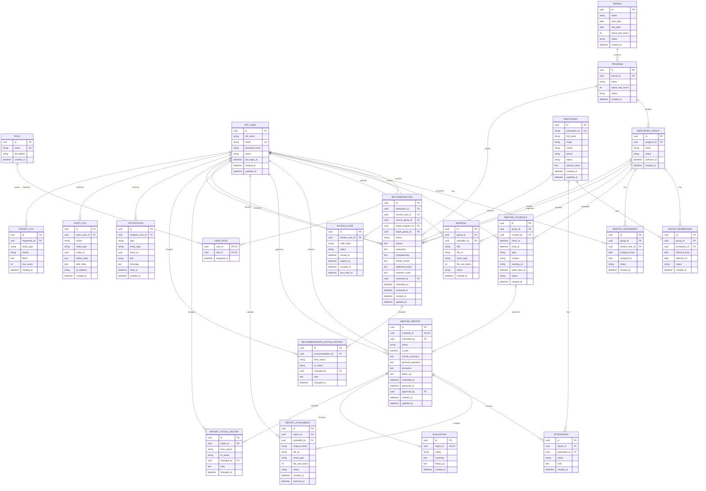

# ERD — Aplikasi Mentoring Mahasiswa

ERD ini menerjemahkan entitas dan aturan bisnis pada PRD menjadi model relasional awal. Nama `APP_USER` digunakan untuk menghindari konflik dengan kata `USER` pada beberapa database.

## 1. Entity Relationship Diagram

## 2. Relasi dan aturan integritas

| Relasi | Aturan |
| --- | --- |
| `APP_USER` — `USER_ROLE` — `ROLE` | Satu pengguna dapat memiliki satu atau beberapa peran. Kombinasi `user_id` dan `role_id` unik. |
| `APP_USER` — `ACCESS_CODE` | Hanya Mentor yang boleh memiliki kode akses. Satu kode disimpan sebagai hash dan tidak pernah ditampilkan ulang. |
| `PERIOD` — `PROGRAM` — `MENTORING_GROUP` | Program berada dalam satu periode; grup berada dalam satu program. |
| `PARTICIPANT` — `GROUP_MEMBERSHIP` — `MENTORING_GROUP` | Keanggotaan memakai `effective_from` dan `effective_to` agar perpindahan peserta tetap memiliki histori. |
| `APP_USER` — `MENTOR_ASSIGNMENT` — `MENTORING_GROUP` | Mentor dapat menangani banyak grup; satu grup dapat memiliki beberapa Mentor. |
| `MEETING_SCHEDULE` — `MEETING_REPORT` | Satu jadwal memiliki paling banyak satu laporan. Laporan dibuat dari jadwal yang terdaftar. |
| `MEETING_REPORT` — `ATTENDANCE` | Satu laporan memiliki satu baris absensi per peserta yang menjadi anggota aktif pada jadwal tersebut. Kombinasi `report_id` dan `participant_id` unik. |
| `MEETING_REPORT` — `REPORT_ATTACHMENT` | Satu laporan dapat memiliki banyak lampiran. Lampiran yang diarsipkan tidak muncul pada tampilan aktif, tetapi tetap tersimpan untuk audit. |
| `MEETING_REPORT` — `REPORT_STATUS_HISTORY` | Setiap perubahan status dicatat dengan pengguna, waktu, dan catatan. |
| `RECOMMENDATION` — `RECOMMENDATION_STATUS_HISTORY` | Setiap pengajuan, peninjauan, dan perubahan keputusan dicatat sebagai histori terpisah dari data rekomendasi saat ini. |
| `EXPORT_LOG` | Setiap ekspor yang berhasil mencatat peminta, format, filter, jumlah baris, dan waktu. Isi data hasil ekspor tidak disalin ke database. |
| `RECOMMENDATION` | Mentor hanya dapat membuat rekomendasi untuk peserta pada grup yang ditugaskan kepadanya. Keputusan peninjau disimpan terpisah dari pengusul. Kolom `mentor_user_id` merujuk ke `APP_USER.id`. |
| Data berhistori | Gunakan `status` atau kolom arsip; hindari hard delete untuk peserta, grup, laporan, rekomendasi, dan akun. |

## 3. Domain status

### Akun dan kode akses

- `APP_USER.status`: `ACTIVE`, `INACTIVE`, `ARCHIVED`.
- `ACCESS_CODE.status`: `ACTIVE`, `EXPIRING_SOON`, `EXPIRED`, `REVOKED`.

### Periode, program, grup, dan peserta

- `PERIOD.status`, `PROGRAM.status`, `MENTORING_GROUP.status`, `PARTICIPANT.status`: `ACTIVE`, `INACTIVE`, `ARCHIVED`.
- `GROUP_MEMBERSHIP.status`: `ACTIVE`, `ENDED`.
- `MENTOR_ASSIGNMENT.status`: `ACTIVE`, `ENDED`.

### Laporan dan absensi

- `MEETING_REPORT.status`: `DRAFT`, `SUBMITTED`, `REVISION_REQUIRED`, `APPROVED`.
- `MEETING_REPORT.is_late` dihitung dari `submitted_at` terhadap `report_due_at`; flag ini tidak menggantikan status laporan.
- `ATTENDANCE.status`: `PRESENT`, `EXCUSED`, `SICK`, `ABSENT`.
- `REPORT_ATTACHMENT.status`: `ACTIVE`, `ARCHIVED`.

### Rekomendasi

- `RECOMMENDATION.status`: `SUBMITTED`, `APPROVED`, `REJECTED`, `NEEDS_EVALUATION`.
- `RECOMMENDATION_STATUS_HISTORY` menyimpan status awal dengan `from_status = NULL`.

### Lampiran dan ekspor

- `MATERIAL.status`: `ACTIVE`, `ARCHIVED`.
- `EXPORT_LOG.format`: `CSV`, `XLSX`.
- `EXPORT_LOG.entity_type` dibatasi pada resource yang boleh diekspor, misalnya `PARTICIPANT`, `MEETING_REPORT`, `ATTENDANCE`, atau `RECOMMENDATION`.

## 4. Constraint database yang disarankan

1. `APP_USER.email`, `PARTICIPANT.participant_no`, `ROLE.name`, dan `MEETING_REPORT.schedule_id` memiliki unique constraint.
2. `ATTENDANCE(report_id, participant_id)` memiliki unique constraint.
3. Tidak boleh ada dua `GROUP_MEMBERSHIP` aktif untuk peserta yang sama pada periode yang sama. Constraint ini dapat diterapkan melalui validasi transaksi atau exclusion constraint sesuai database.
4. Tidak boleh ada dua kode `ACCESS_CODE` aktif untuk Mentor yang sama.
5. `MEETING_REPORT.submitted_by` harus merupakan Mentor yang memiliki penugasan aktif pada grup jadwal tersebut.
6. `RECOMMENDATION.mentor_user_id` harus memiliki penugasan aktif pada `source_group_id` saat pengajuan dibuat.
7. `RECOMMENDATION.target_group_id`, jika diisi, harus berada pada program yang sama dengan `target_program_id`.
8. `effective_to` tidak boleh lebih awal dari `effective_from`; aturan yang sama berlaku untuk `assigned_to` dan `assigned_from`.
9. Penghapusan fisik dibatasi untuk data teknis yang tidak memiliki riwayat. Data operasional menggunakan soft delete atau arsip.
10. `PROGRAM.report_due_hours` boleh `NULL`; jika `NULL`, sistem memakai `PERIOD.report_due_hours`. Nilai efektif disalin ke `MEETING_SCHEDULE.report_due_at` saat jadwal dibuat atau ketika tenggat dihitung ulang.
11. `REPORT_ATTACHMENT.file_size_bytes` harus positif dan dibatasi oleh konfigurasi ukuran maksimum aplikasi. `file_url` hanya menunjuk object storage, bukan isi biner di database.
12. `RECOMMENDATION_STATUS_HISTORY` dan `REPORT_STATUS_HISTORY` hanya boleh menambahkan baris; koreksi dilakukan melalui audit, bukan mengubah histori lama.
13. `EXPORT_LOG.filters` tidak boleh berisi kode akses, kata sandi, atau data sensitif yang tidak diperlukan untuk mengulang filter.

## 5. Indeks yang disarankan

- `APP_USER(email, status)` untuk login.
- `ACCESS_CODE(mentor_user_id, status, expires_at)` untuk validasi kode.
- `PROGRAM(period_id, status)` dan `MENTORING_GROUP(program_id, status)` untuk navigasi program.
- `GROUP_MEMBERSHIP(participant_id, status)` dan `GROUP_MEMBERSHIP(group_id, status)` untuk daftar anggota.
- `MENTOR_ASSIGNMENT(mentor_user_id, status)` dan `MENTOR_ASSIGNMENT(group_id, status)` untuk akses berbasis grup.
- `MEETING_SCHEDULE(group_id, starts_at)` untuk jadwal.
- `MEETING_REPORT(status, submitted_at, is_late)` untuk antrean dan monitoring.
- `ATTENDANCE(participant_id, report_id)` untuk rekap kehadiran.
- `RECOMMENDATION(status, submitted_at)` untuk antrean peninjauan.
- `RECOMMENDATION_STATUS_HISTORY(recommendation_id, changed_at)` untuk kronologi keputusan.
- `REPORT_ATTACHMENT(report_id, status)` untuk daftar lampiran aktif.
- `EXPORT_LOG(requested_by, created_at)` untuk riwayat ekspor per pengguna.
- `AUDIT_LOG(entity_type, entity_id, created_at)` untuk riwayat objek.

## 6. Catatan implementasi

- Gunakan UUID sebagai primary key agar aman untuk impor dan integrasi di masa depan.
- Simpan seluruh timestamp dalam UTC dan lakukan konversi pada lapisan aplikasi.
- `code_hash`, `password_hash`, dan token sensitif tidak boleh masuk ke `AUDIT_LOG.before_data` atau `after_data`.
- Lampiran sebaiknya disimpan di object storage; database hanya menyimpan URL, tipe file, ukuran, dan metadata.
- Jika kebutuhan evaluasi berkembang menjadi beberapa evaluasi per laporan atau per peserta, `EVALUATION` dapat diubah menjadi tabel detail dengan foreign key ke `MEETING_REPORT` dan `PARTICIPANT`.

## 7. Keputusan model untuk implementasi

### 7.1 Tenggat laporan

`PERIOD.report_due_hours` menjadi default periode. `PROGRAM.report_due_hours` menjadi override opsional. Saat jadwal disimpan, aplikasi menghitung `report_due_at` dari waktu selesai pertemuan ditambah nilai efektif. Menyimpan nilai absolut pada jadwal menjaga histori tetap stabil ketika konfigurasi program berubah di kemudian hari.

### 7.2 Lampiran laporan

Lampiran laporan dipisahkan dari `MATERIAL` karena siklus hidup dan hak aksesnya berbeda. `MATERIAL` adalah materi yang tersedia untuk grup, sedangkan `REPORT_ATTACHMENT` adalah bukti atau dokumen yang melekat pada satu laporan.

### 7.3 Histori status

Kolom `status` pada tabel utama dipakai untuk membaca kondisi terkini dengan cepat. Tabel histori dipakai untuk menelusuri urutan perubahan. Transaksi perubahan status harus memperbarui keduanya secara atomik.

### 7.4 Rekomendasi dan penempatan lanjutan

`target_program_id` wajib diisi ketika status menjadi `APPROVED`. `target_group_id` boleh `NULL` saat baru disetujui jika penempatan grup dilakukan kemudian. Jika `target_group_id` diisi, program grup tersebut harus sama dengan `target_program_id`.

## 8. Matriks akses data

| Entitas | Admin | Tim Mentoring | Mentor | Analis |
| --- | --- | --- | --- | --- |
| `APP_USER`, `ROLE`, `ACCESS_CODE` | Kelola | Lihat terbatas | Lihat akun sendiri | Lihat terbatas |
| `PERIOD`, `PROGRAM`, `MENTORING_GROUP` | Kelola | Kelola | Lihat grup ditugaskan | Lihat semua |
| `PARTICIPANT`, `GROUP_MEMBERSHIP` | Kelola | Kelola | Lihat grup ditugaskan | Lihat semua |
| `MEETING_SCHEDULE`, `MATERIAL` | Kelola | Kelola | Lihat grup ditugaskan | Lihat semua |
| `MEETING_REPORT`, `ATTENDANCE`, `EVALUATION` | Lihat/ekspor | Tinjau/kelola | Buat/ubah milik sendiri sesuai status | Lihat/ekspor |
| `RECOMMENDATION` | Lihat/ekspor | Tinjau/putuskan | Buat untuk grup ditugaskan | Lihat |
| `AUDIT_LOG`, `EXPORT_LOG` | Lihat | Lihat sesuai kewenangan | Tidak dapat mengubah | Lihat monitoring |

Pembatasan pada matriks ini ditegakkan di lapisan aplikasi dan query database. Foreign key menjaga referensi; foreign key saja tidak cukup untuk menegakkan kewenangan berbasis grup.

## 9. Urutan transaksi kritis

1. **Kirim laporan:** kunci jadwal dan laporan, validasi semua anggota aktif memiliki absensi, hitung `is_late`, ubah status, tulis histori status, lalu buat notifikasi.
2. **Kembalikan laporan:** validasi status `SUBMITTED`, simpan catatan revisi pada histori, ubah ke `REVISION_REQUIRED`, lalu beri notifikasi kepada pengirim.
3. **Pindah peserta:** tutup `GROUP_MEMBERSHIP` lama, buat keanggotaan baru, dan tulis satu entri `AUDIT_LOG` dalam transaksi yang sama.
4. **Setujui rekomendasi:** validasi peninjau berwenang, isi keputusan dan target, ubah status, serta tulis `RECOMMENDATION_STATUS_HISTORY` secara atomik.
