# User Flow — Aplikasi Mentoring Mahasiswa

Dokumen ini memetakan perjalanan utama pengguna berdasarkan PRD aplikasi mentoring mahasiswa.

## 1. Peta navigasi umum

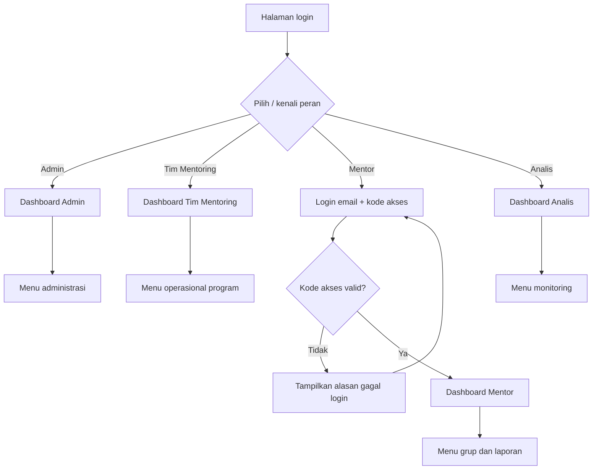

## 2. Alur akses berdasarkan peran

### 2.1 Admin, Tim Mentoring, dan Analis

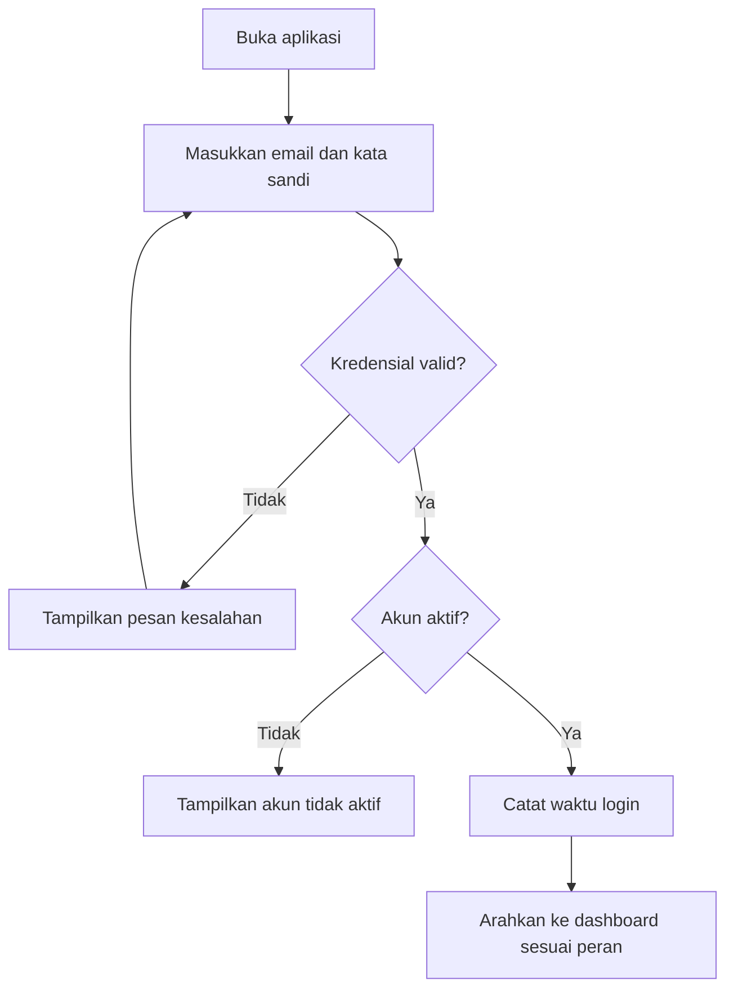

### 2.2 Mentor

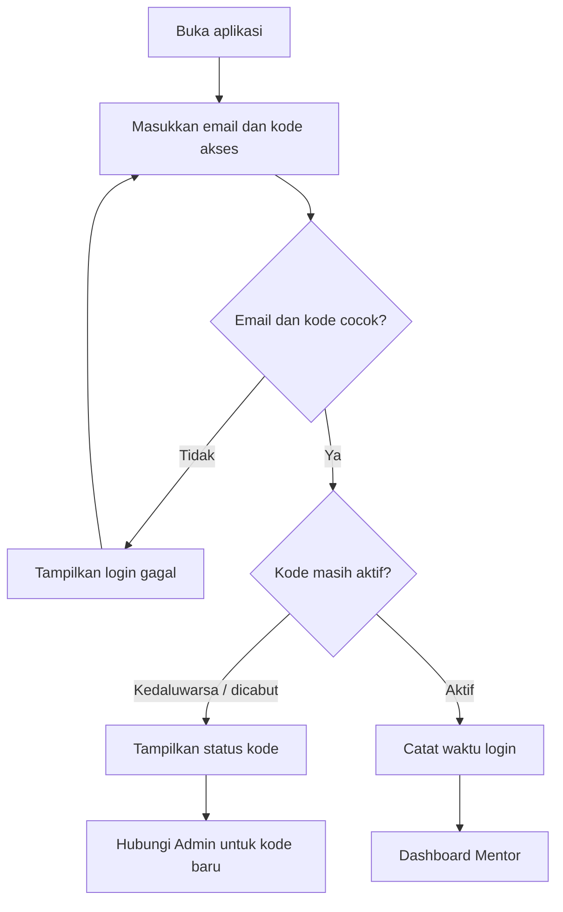

## 3. User flow Admin

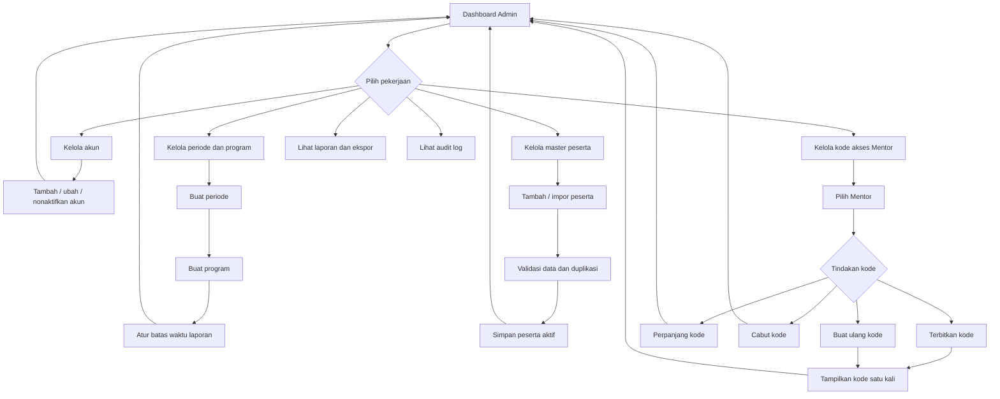

## 4. User flow Tim Mentoring

### 4.1 Menyiapkan program dan grup

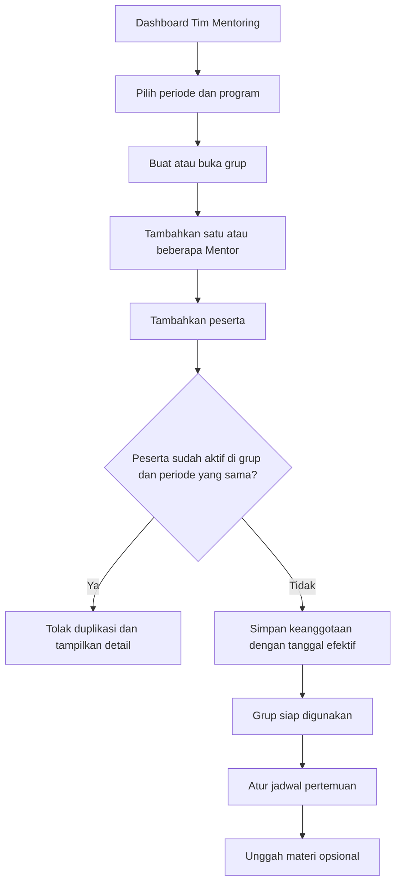

### 4.2 Memindahkan peserta

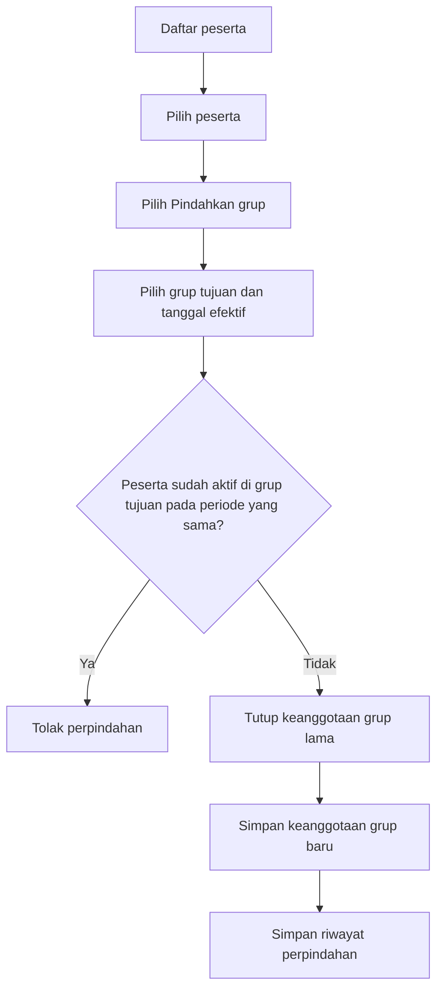

### 4.3 Meninjau laporan

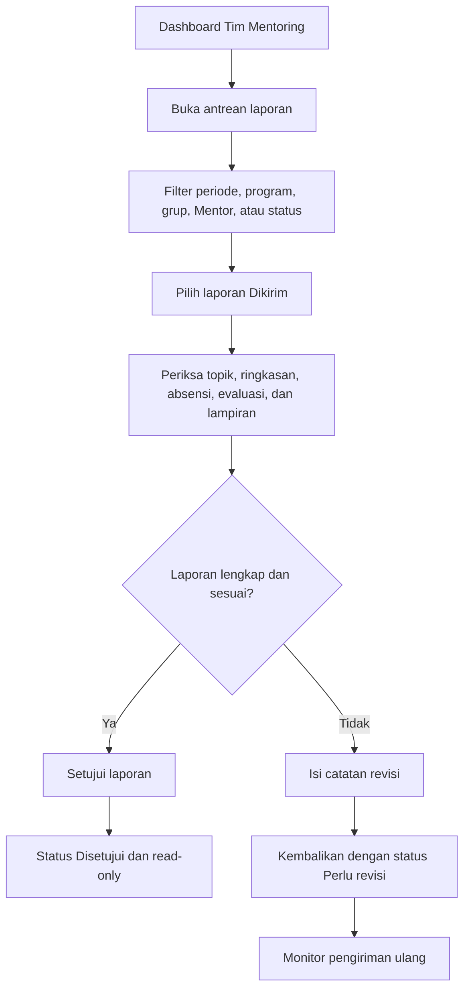

### 4.4 Meninjau rekomendasi mentoring lanjutan

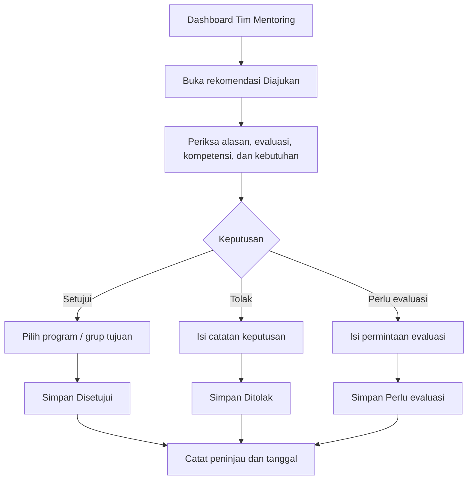

## 5. User flow Mentor

### 5.1 Melihat tugas

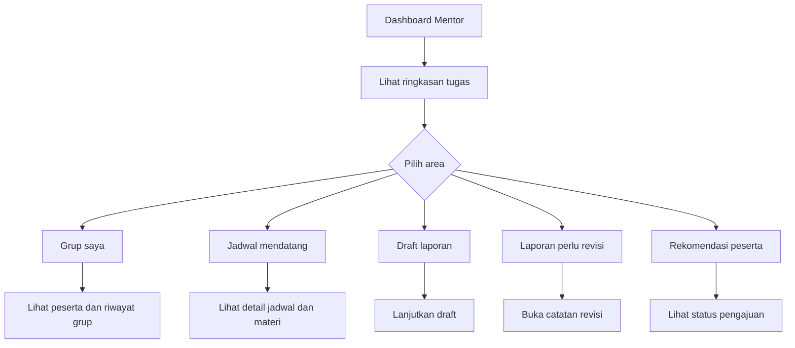

### 5.2 Mengisi dan mengirim laporan pertemuan

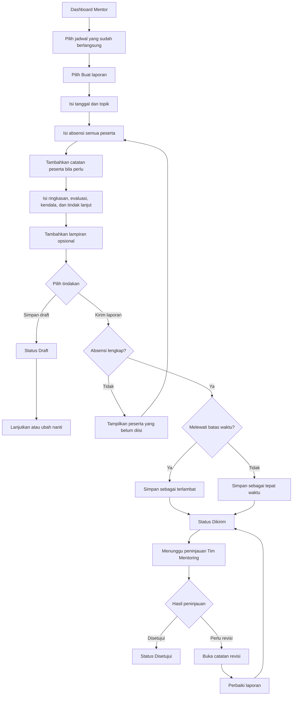

### 5.3 Mengajukan rekomendasi mentoring lanjutan

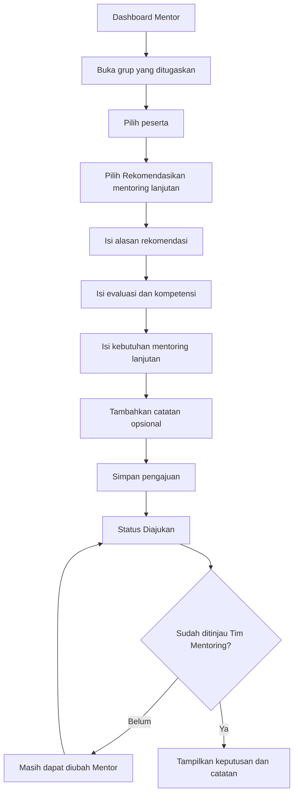

## 6. User flow Analis

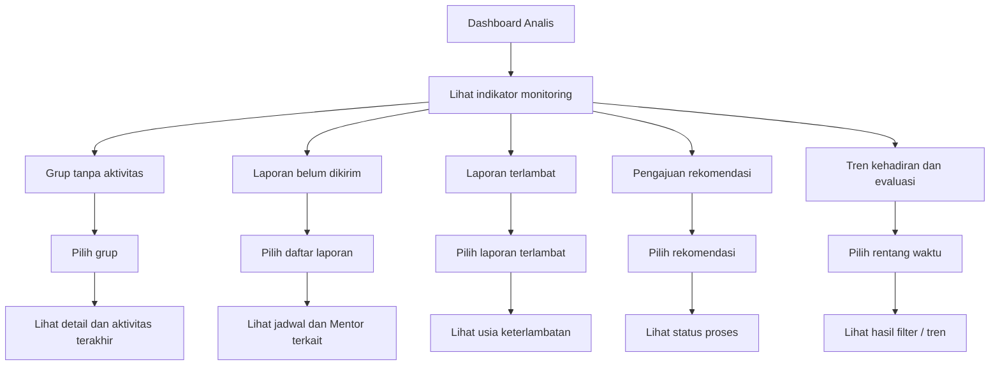

## 7. Alur status laporan

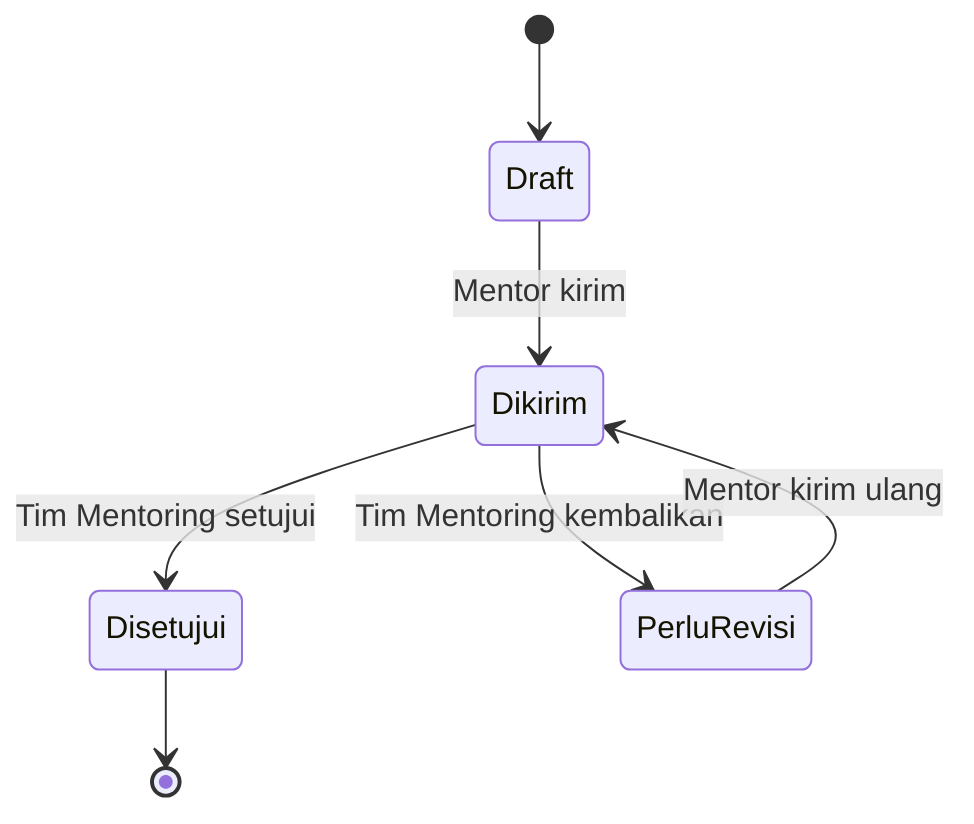

Catatan: status terlambat adalah penanda waktu pada laporan, bukan status pengganti. Laporan terlambat tetap dapat berada pada status Draft, Dikirim, Perlu revisi, atau Disetujui.

## 8. Alur status kode akses Mentor

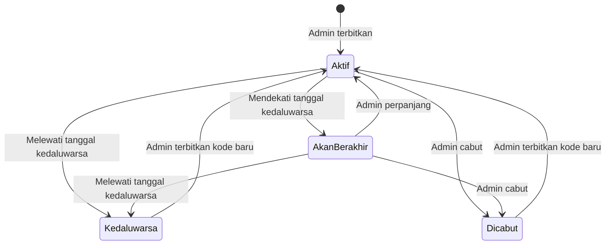

## 9. Alur pengecualian yang harus terlihat pengguna

| Situasi | Respons sistem |
| --- | --- |
| Login dengan akun nonaktif | Tampilkan status akun dan arahkan ke Admin |
| Login dengan kode Mentor kedaluwarsa | Tampilkan tanggal kedaluwarsa dan instruksi menghubungi Admin |
| Peserta duplikat dalam grup/periode | Tolak penyimpanan dan tampilkan data yang bentrok |
| Laporan tanpa absensi lengkap | Tahan pengiriman dan tandai peserta yang belum diisi |
| Laporan dikembalikan | Tampilkan catatan revisi pada halaman laporan dan dashboard Mentor |
| Mentor membuka peserta dari grup lain | Tolak akses dan arahkan kembali ke grup yang ditugaskan |
| Grup atau program diarsipkan | Hilangkan dari pilihan data baru, tetapi pertahankan riwayat |
| Ekspor tanpa hak akses | Tolak permintaan dan catat percobaan akses bila diperlukan |

## 10. Jalur terpendek untuk tugas inti

| Tugas | Jalur utama |
| --- | --- |
| Mentor mengirim laporan | Login → Dashboard → Jadwal → Buat laporan → Absensi → Isi laporan → Kirim |
| Tim Mentoring menyetujui laporan | Login → Dashboard → Antrean laporan → Filter → Buka laporan → Setujui |
| Admin menerbitkan kode Mentor | Login → Dashboard → Akun Mentor → Pilih Mentor → Terbitkan kode |
| Tim Mentoring menempatkan peserta | Login → Dashboard → Program → Grup → Tambah peserta → Simpan |
| Mentor merekomendasikan peserta | Login → Dashboard → Grup → Peserta → Rekomendasikan → Kirim |
| Analis menemukan laporan terlambat | Login → Dashboard → Laporan terlambat → Filter → Buka detail |
